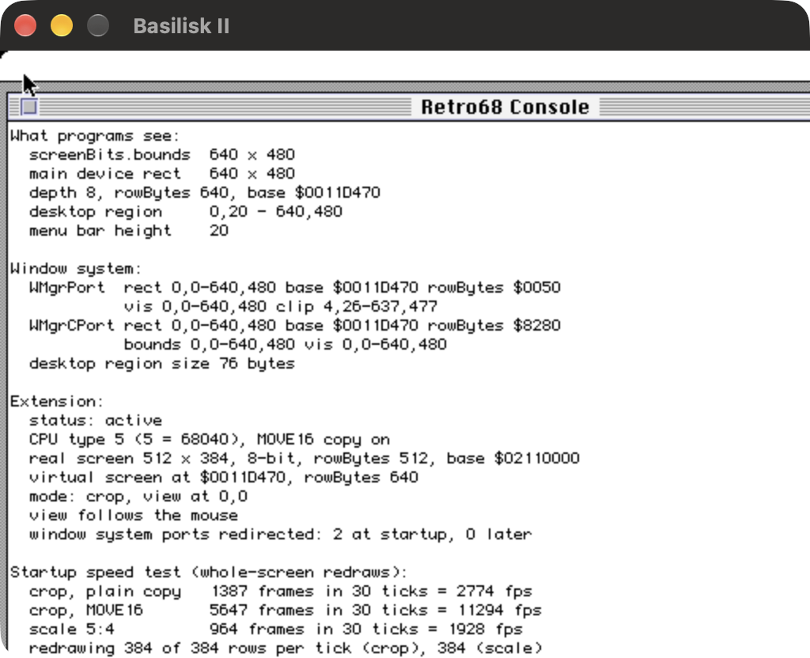
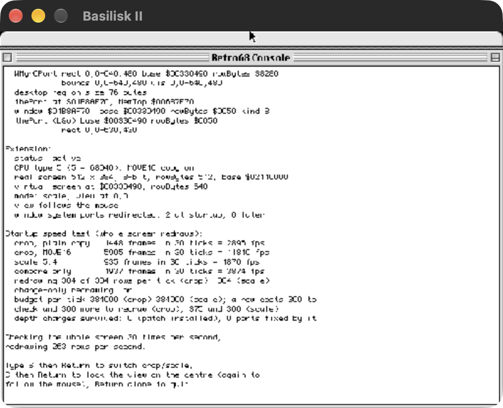

# Fit640 (proof of concept)

A system extension for Color Classic-family Macs with the built-in 512×384
screen (Color Classic II, or a Color Classic with an LC/Performa 550 or
"Mystic" LC 575 board, with or without a 68040 upgrade) that makes the Mac
believe its main screen is 640×480 while the CRT stays in its stock mode, so
software that insists on 640×480 will run without the hardware 640×480
modification. See [DESIGN.md](DESIGN.md) for the background.

| Crop: a 512×384 window at full size | Scale: the whole 640×480 shrunk |
|---|---|
|  |  |

## Status

Early and experimental. One build covers System 7.5 through Mac OS 8.1, on
68030 and 68040.

- **Emulator (Basilisk II, 512×384):** boots and displays correctly on
  System 7.5.3 and Mac OS 8.1 with a 68040, and on System 7.5.3 with a 68030
  (Mac IIci ROM), in crop and scale. Depth changes while running (256 colors
  to thousands, black-and-white to 256 colors) keep the 640×480 screen.
- **Real hardware:** earlier versions loaded and ran on a Color Classic
  (Performa 550 board, Sonnet Presto Plus 68040) under System 7.6.1, but
  redrawing was too slow to be comfortable. Change-only redrawing was added
  in response and has not been tried on real hardware yet. Nothing has been
  tried on a real 68030.
- **Not tested at all:** the hot keys, any game.

## What it does

- At startup it allocates a 640×480 screen buffer in the system heap, points
  the main screen and the window system's existing ports at it, and tells the
  system the screen is 640×480. Programs that check the screen size through
  QuickDraw or the main graphics device see 640×480.
- A screen-refresh task copies part of that buffer to the real screen:
  - **Crop** (default): a 1:1 512×384 window. It starts at the top-left, so
    the menu bar is where you expect, and follows the mouse when the pointer
    reaches an edge.
  - **Scale**: the whole 640×480 picture shrunk to 512×384 (256 colors only).
    Small text suffers.
- **Only what changed is redrawn.** The task compares the buffer with a copy
  of what is already on screen and writes just the differing part of each
  row to video memory. The rows around the mouse pointer are checked every
  1/60 s so the pointer stays responsive; the rest of the screen is swept
  top to bottom as fast as the budget allows.
- **The budget comes from a startup speed test** (about 2 seconds; the
  picture shrinks briefly during the scale test). Redrawing is limited to
  about a third of the processor, so a slow machine updates less often
  instead of becoming unresponsive.
- **Color depth changes are followed.** When the Monitors control panel or a
  game changes the depth, the extension lets the change happen and puts the
  640×480 screen back at the new depth.

Hot keys:

| Keys | Effect |
|---|---|
| Control-Option-S | switch between crop and scale |
| Control-Option-C | lock the crop window on the centre of the screen; again to follow the mouse |
| Control held during startup | avoid the 68040 MOVE16 instruction (see Install) |

**Fit640Info** is a small app that shows what screen size programs now see,
the extension's status, and the timing results, and saves the same report
with extra detail to a text file named `Fit640 Log` next to itself. It can also switch modes: type
S or C, then Return.

Known limits:

- Programs that ask the video driver or the Display Manager for a list of
  supported resolutions still get the real hardware's answer (512×384 only).
- **Use 256 colors.** Thousands of colors works but doubles the redraw work.
- 32-bit addressing must be on.
- It takes about 1.3 MB of memory (two screen buffers sized for thousands of
  colors).
- Full-screen animation still has to be copied whole, at whatever rate the
  hardware manages.
- No control panel and no per-game settings.

## Install

Test on a system you can afford to break.

1. Set the screen to 256 colors.
2. Copy `Fit640` into the System Folder's Extensions folder. Restart.
3. Run `Fit640Info`.

If something goes wrong:

- **Freeze or garbage during startup:** restart holding **Control** from the
  moment extensions begin loading. That avoids the 68040 MOVE16 instruction,
  the most likely thing an accelerator card might not handle when writing to
  video memory.
- **Anything else:** restart holding **Shift** (extensions off) and remove
  `Fit640` from the Extensions folder.

## Build

Needs the [Retro68](https://github.com/autc04/Retro68) toolchain (expected in
`~/Retro68/build/toolchain`; set `RETRO68` to use another location) and
Python 3.

```bash
./build.sh
```

Output, each holding the `Fit640` extension and the `Fit640Info` app:

- `build/Fit640.sit`: a StuffIt archive in the original 1.5.1 format, stored
  without compression, so any version of StuffIt or StuffIt Expander opens it.
  This is the easiest one to move to a real Mac.
- `build/Fit640.dsk`: a raw 1.4 MB disk image for emulators and SCSI/floppy
  emulators. It has no Disk Copy header, so Disk Copy will not mount it.
- `build/Fit640.bin` and `build/Fit640Info.bin`: the two files in MacBinary form.

## Emulator testing

`tools/emutest.sh` boots a throwaway copy of a system disk image in
Basilisk II (512×384) with the freshly built extension installed and the
info app in Startup Items, saves a picture of the emulator window, and prints
the info app's log. You supply the ROM and the system disk image; see the
comments at the top of the script for the options (system image, 68030 or
68040, and test hooks for scale mode, a depth change and a slow machine).

## Files

| File | What it is |
|---|---|
| `src/Fit640.c` | the extension |
| `src/Blit.s` | the copy and shrink loops, in 68k assembly |
| `src/Fit640.h` | the status block shared with the info app |
| `src/Fit640.r` | resource definitions |
| `info/Fit640Info.c` | the info app |
| `tools/mksit.py` | packs the built files into the `.sit` archive |
| `tools/emutest.sh` | automated emulator test |

## License

MIT; see [LICENSE](LICENSE). Built programs link the Retro68 runtime library,
which is GPLv3 with the GCC Runtime Library Exception.
