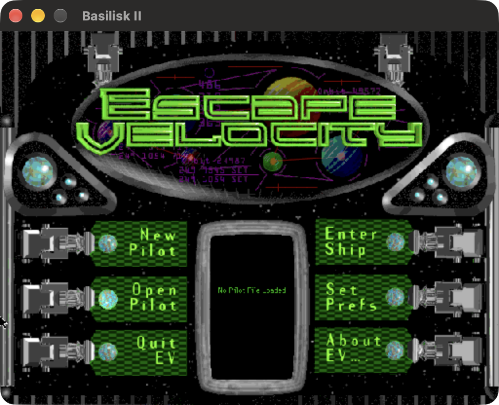
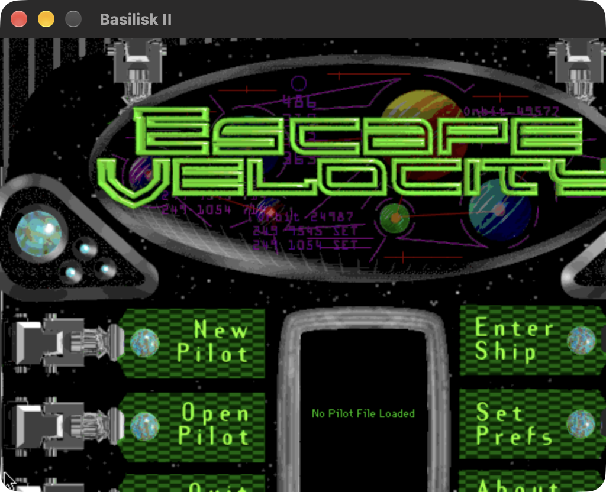
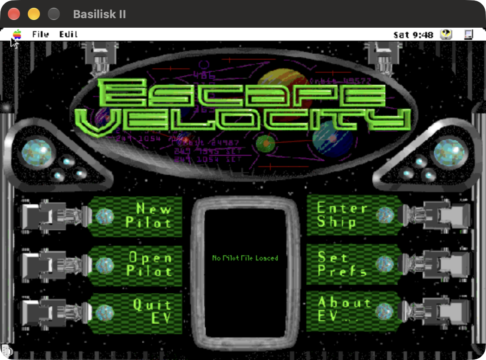

# Fit640 (proof of concept)

A system extension for Color Classic-family Macs with the built-in 512×384
screen (Color Classic, Color Classic II, or a Color Classic with an
LC/Performa 550 or "Mystic" LC 575 board, with or without a 68040 upgrade)
that makes the Mac
believe its main screen is 640×480 while the CRT stays in its stock mode, so
software that insists on 640×480 will run without the hardware 640×480
modification. See [DESIGN.md](DESIGN.md) for the background.

| Scale: the whole 640×480 shrunk to fit (default) | Crop: a 512×384 window at full size |
|---|---|
|  |  |

Escape Velocity 1.0.5 on System 7.6.1 in an emulated 512×384 Mac. Without
Fit640 it stops at "an error occurred while trying to open the Monitor Tool.
ID = -3".

Boards that also offer **560×384** in the Monitors control panel (the
LC/Performa 550 board does) can use it for a sharper picture: Fit640 then
shrinks 640 pixels to 560 instead of 512. On the real CRT 560×384 fills the
same screen area, so the proportions stay right; the emulator window below
shows it wider only because its pixels are square.



## Status

Early and experimental. One build covers System 7.5 through Mac OS 8.1, on
68030 and 68040.

- **Emulator (Basilisk II, 512×384 and 560×384):** boots and displays correctly on
  System 7.5.3, 7.6.1 and Mac OS 8.1 with a 68040, and on System 7.5.3 with a
  68030 (Mac IIci ROM). Depth changes and switching the 640×480 screen off
  and on while running work on all three systems. Escape Velocity 1.0.5
  reaches its main menu on 7.6.1; it has not been played beyond that.
- **Real hardware:** earlier versions loaded and ran on a Color Classic
  (Performa 550 board, Sonnet Presto Plus 68040) under System 7.6.1, but
  redrawing was too slow to be comfortable. Change-only redrawing, the
  on/off switch and the Control Strip module have not been tried on real
  hardware yet. Nothing has been tried on a real 68030.
- **Control Strip module:** tested with simulated clicks on System 7.5.3
  (68030 and 68040). Not tested on 7.6.1 or 8.1.
- **Not tested at all:** the hot keys.

## What it does

- At startup it allocates a 640×480 screen buffer in the system heap, points
  the main screen and the window system's existing ports at it, and tells the
  system the screen is 640×480. Programs that check the screen size through
  QuickDraw or the main graphics device see 640×480.
- A screen-refresh task copies that buffer to the real screen in one of two
  ways:
  - **Scale** (default): the whole 640×480 picture shrunk to the real
    screen, so everything is reachable. Small text suffers. Needs 256
    colors; at other depths it shows crop.
  - **Crop**: a 1:1 window the size of the real screen that follows the
    mouse when the pointer reaches an edge.
- **It adapts to the real screen size.** 512×384 is the normal case and all
  that a stock Color Classic board offers. If the real screen is 560×384,
  at startup or after a change in the Monitors control panel, scale and crop
  both use the extra width.
- **Only what changed is redrawn.** The task compares the buffer with a copy
  of what is already on screen and writes just the differing part of each
  row to video memory. The rows around the mouse pointer are checked every
  1/60 s; the rest of the screen is swept top to bottom as fast as the
  budget allows.
- **The budget comes from a startup speed test** (about 2 seconds; the
  picture shrinks briefly during the scale test). Redrawing is limited to
  about a third of the processor.
- **Color depth changes are followed.** When the Monitors control panel or a
  game changes the depth, the 640×480 screen is put back at the new depth.
- **It can be switched off and on without restarting.** Switching goes
  through the Display Manager, so the system rebuilds the desktop and moves
  windows and the Control Strip for the new size. The on/off state and the
  scale/crop choice are saved in `Fit640 Prefs` in the Preferences folder.

## Controls

**Control Strip module** (`Fit640Strip`): two small buttons.

| Button shows | Meaning | Click to |
|---|---|---|
| `640` / `512` | the 640×480 screen is on / off (it shows `512` when off, whatever the real size) | switch it |
| `Fit` / `1:1` | scale to fit / crop at full size | switch it |

**Hot keys**

| Keys | Effect |
|---|---|
| Control-Option-S | switch between scale and crop (not saved) |
| Control-Option-C | crop only: lock the window on the centre of the screen; again to follow the mouse |
| Control held during startup | avoid the 68040 MOVE16 instruction (see Install) |

**Fit640Info** is a small app that shows what screen size programs now see,
the extension's status, and the timing results, and saves the same report
with extra detail to a text file named `Fit640 Log` next to itself. Typing a
letter and Return also works as a control: S (scale/crop), C (centre lock),
O (640×480 on/off).

## Known limits

- Programs that ask the video driver or the Display Manager for a list of
  supported resolutions still get the real hardware's answer (512×384 only).
- **Use 256 colors.** Thousands of colors works but doubles the redraw work
  and cannot be scaled.
- 32-bit addressing must be on.
- It takes about 1.3 MB of memory (two screen buffers sized for thousands of
  colors).
- Full-screen animation still has to be copied whole, at whatever rate the
  hardware manages.
- Switching on and off while running needs the Display Manager (System 7.5
  and later). Programs that were already open keep the screen size they
  first saw.

## Install

Test on a system you can afford to break.

1. Set the screen to 256 colors.
2. Copy `Fit640` into the System Folder's Extensions folder.
3. Copy `Fit640Strip` into the System Folder's Control Strip Modules folder
   (optional).
4. Restart, then run `Fit640Info`.

If something goes wrong:

- **Freeze or garbage during startup:** restart holding **Control** from the
  moment extensions begin loading. That avoids the 68040 MOVE16 instruction,
  the most likely thing an accelerator card might not handle when writing to
  video memory.
- **Anything else:** restart holding **Shift** (extensions off) and remove
  `Fit640` from the Extensions folder.

## Build

Needs the [Retro68](https://github.com/autc04/Retro68) toolchain (expected in
`~/Retro68/build/toolchain`; set `RETRO68` to use another location) and
Python 3.

```bash
./build.sh
```

Output, each holding the `Fit640` extension, the `Fit640Strip` Control Strip
module and the `Fit640Info` app:

- `build/Fit640.sit`: a StuffIt archive in the original 1.5.1 format, stored
  without compression, so any version of StuffIt or StuffIt Expander opens it.
  This is the easiest one to move to a real Mac.
- `build/Fit640.dsk`: a raw 1.4 MB disk image for emulators and SCSI/floppy
  emulators. It has no Disk Copy header, so Disk Copy will not mount it.
- `build/Fit640.bin`, `build/Fit640Strip.bin` and `build/Fit640Info.bin`: the
  three files in MacBinary form.

## Emulator testing

`tools/emutest.sh` boots a throwaway copy of a system disk image in
Basilisk II (512×384) with the freshly built files installed and the info app
in Startup Items, saves a picture of the emulator window, and prints the info
app's log. You supply the ROM and the system disk image; see the comments at
the top of the script for the options: system image and folder, 68030 or
68040, and test hooks for scale or crop, a depth change, switching off and
on, a slow machine, simulated clicks on the Control Strip module, and
launching a program after the report.

## Files

| File | What it is |
|---|---|
| `src/Fit640.c` | the extension |
| `src/Blit.s` | the copy, shrink and compare loops, in 68k assembly |
| `src/Fit640.h` | the status block shared with the module and the info app |
| `src/Fit640.r` | resource definitions |
| `strip/Fit640Strip.c` | the Control Strip module |
| `info/Fit640Info.c` | the info app |
| `tools/mksit.py` | packs the built files into the `.sit` archive |
| `tools/emutest.sh` | automated emulator test |

## License

MIT; see [LICENSE](LICENSE). Built programs link the Retro68 runtime library,
which is GPLv3 with the GCC Runtime Library Exception.
